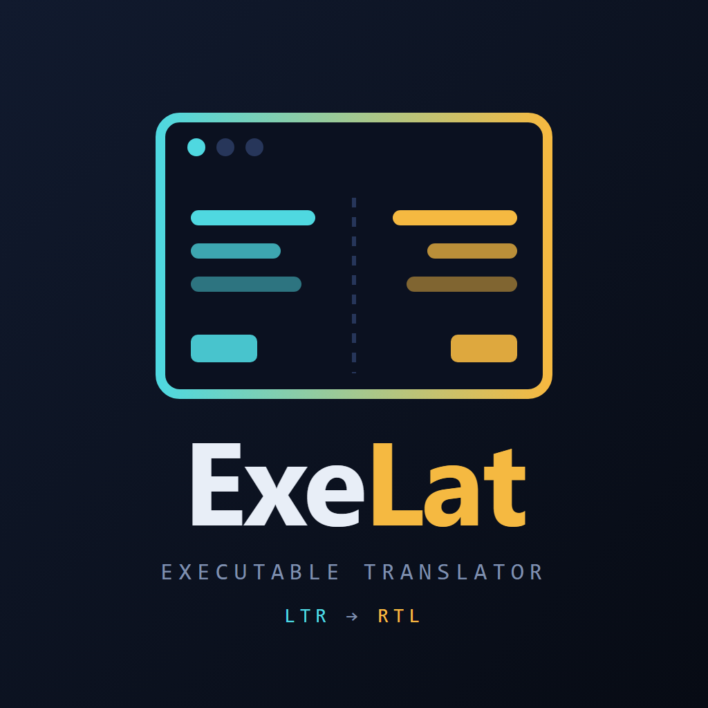
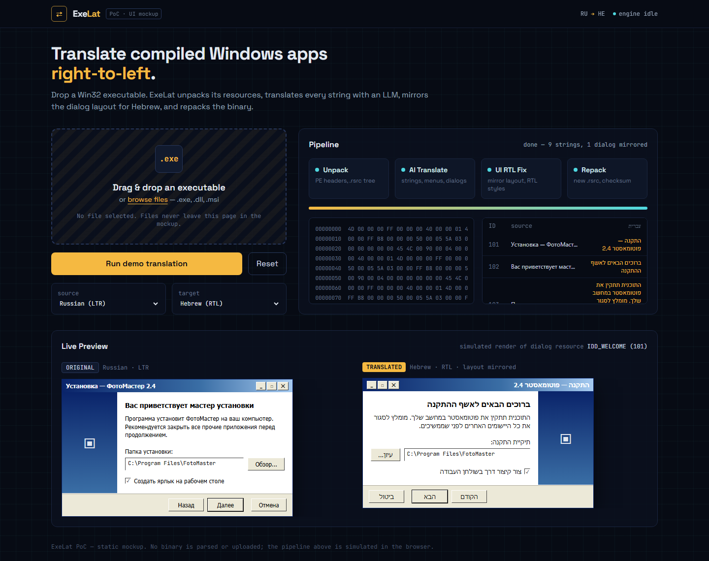
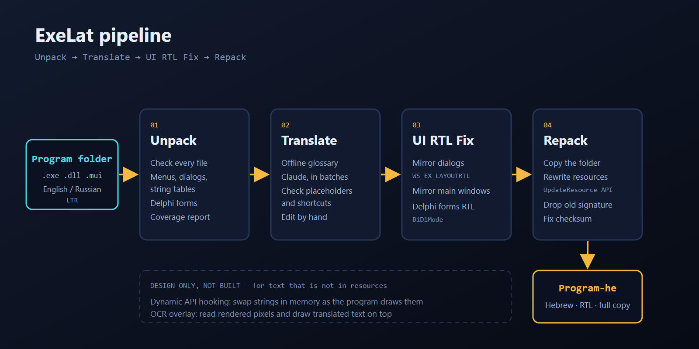

<p align="center">
  
</p>

<h1 align="center">ExeLat — Executable Translator</h1>

<p align="center">
  <b>Translate compiled Windows programs into Hebrew — text and right-to-left layout — without the source code.</b>
</p>

<p align="center">
  <a href="https://github.com/dor2500/ExeLat-PoC/releases/latest"></a>
  
  
  
</p>

---

## 📖 Project Overview

Plenty of useful Windows software was never released in Hebrew, and its source code is not available. **ExeLat** localises such a program directly from its compiled `.exe`:

1. **Unpack** — reads the program's menus, dialogs and string tables out of the PE resource section.
2. **Translate** — standard terms from a built-in glossary, everything else with Claude (or by hand).
3. **UI RTL fix** — marks every dialog, and optionally every main window, as mirrored, so Windows lays the interface out right-to-left.
4. **Repack** — writes a translated copy of the executable. The original is never modified.



### Verified result

- **Win32:** 7-Zip File Manager (`7zFM.exe`, 406 distinct UI texts) was translated end to end in about 30 seconds. The output starts, its main window reports `WS_EX_LAYOUTRTL`, and its menu reads `קובץ → פתח, שנה שם, מחק, מאפיינים, צור תיקיה…` with shortcuts (`F2`, `Ctrl+N`) intact.
- **Delphi:** Inno Setup Compiler (`Compil32.exe`, 14 forms, 694 texts) was rebuilt with translated forms. The output starts, its forms report right-to-left reading, and form titles and buttons show the Hebrew text.

## ⬇️ Download

Get **`ExeLat.exe`** from the [latest release](https://github.com/dor2500/ExeLat-PoC/releases/latest). It is a single file; nothing to install. Windows 10/11 already include the WebView2 runtime it uses.

The file is not code-signed, so SmartScreen will show "Windows protected your PC" the first time. Choose **More info → Run anyway**, or build it yourself from source (below).

## 🚀 How to use

1. Open `ExeLat.exe` and drop a program on it (or click to choose a file).
2. Review the **Live Preview**: every dialog, original on one side, mirrored Hebrew on the other.
3. Press **Translate missing with AI**. Pick how to reach Claude:
   - **Claude Code (this PC)** — uses the `claude` command line if it is installed. No API key.
   - **Anthropic API key** — paste a key; it is used for that request only and never saved.
4. Fix anything you like by typing in the Hebrew column. The preview updates as you type.
5. Press **Build translated EXE** and save the new file **next to the original**, so it finds its DLLs.

Programs installed under `C:\Program Files` cannot be written to without administrator rights. Save the output elsewhere and copy it over, or run ExeLat as administrator.

## ✨ Features

### 📦 Static Translation — implemented
- Reads and rewrites `RT_STRING`, `RT_DIALOG` (both `DLGTEMPLATE` and `DLGTEMPLATEEX`) and `RT_MENU` (classic and extended) resources.
- Every parser has a matching serializer, and a resource is only modified if rebuilding it unchanged reproduces the original bytes. This check passes for all 4,211 resources tested across ~400 Windows system files and third-party programs.
- **Delphi / C++Builder programs:** reads and rewrites binary form resources (`TPF0` in `RT_RCDATA`), translating `Caption`, `Hint` and list items, and sets `BiDiMode = bdRightToLeft` on each form. Round-trip check passes for all 109 forms found in 16 real programs.
- AI translations are validated before use: placeholders (`%s`, `%1`, `{0}`) and keyboard shortcuts must survive unchanged, otherwise the string is left for you.
- Mirrors dialogs with `WS_EX_LAYOUTRTL`. Mirrors main windows by prefixing the version resource's `FileDescription` with two left-to-right marks, which makes Windows enable RTL layout for the whole process.
- Writes the result with the Windows resource-update API, removes the now-invalid Authenticode signature, carries over appended data, and recomputes the PE checksum.

### 🪝 Dynamic API Hooking — design only
For programs that build their text in code. A helper DLL would hook `CreateWindowExW`, `SetWindowTextW`, `DrawTextW` and friends and substitute strings at runtime. Not implemented.

### 🔍 OCR Overlay — design only
For programs that draw their own UI as pixels. Capture the window, OCR it, and draw Hebrew in a click-through overlay. Not implemented.



## ⚠️ What it can and cannot translate

ExeLat changes text that lives in **Win32 resources** and **Delphi forms**. That covers classic Win32, MFC and Delphi / C++Builder programs. It does **not** reach:

| Not translated | Why |
|---|---|
| Text built in code | It is in the compiled instructions, not in a resource |
| .NET (WinForms/WPF), Qt, Electron, Java apps | They keep their UI in their own formats |
| Programs with external language files | Translate those files instead (7-Zip, for example, also has `Lang\*.txt`) |
| Packed or self-verifying executables | They detect the change and refuse to run |
| Installers | Their payload is appended data that most installers checksum |

Other things to know:

- **Signatures.** The output is unsigned. Windows may warn about it until you sign it yourself.
- **`.mui` files.** Modern Windows components keep resources in `en-US\app.exe.mui`. ExeLat tells you when an `.exe` has none of its own; open the `.mui` file instead.
- **Non-Unicode programs** show Hebrew only when the Windows "language for non-Unicode programs" is Hebrew.
- **Layout.** Mirroring is done by Windows; controls are not resized, so a long translation can be clipped.
- **Delphi.** Forms get right-to-left reading and alignment, but control positions are not mirrored, and there is no visual preview for them.
- **AI usage.** A large program is several hundred texts, sent in batches of 60. Through Claude Code this counts against your plan's usage limit; through the API it is billed to your key. If the limit is reached, ExeLat stops, keeps what was translated, and you can continue later.

## 🧰 Tech Stack

| Layer | Technology |
|---|---|
| PE parsing | [`pefile`](https://github.com/erocarrera/pefile) |
| Resource formats | Own parsers/serializers (`pe_resources.py`) |
| Writing the executable | Windows `BeginUpdateResource` / `UpdateResource` / `EndUpdateResource` via `ctypes` |
| Translation | Claude through the official [`anthropic`](https://github.com/anthropics/anthropic-sdk-python) SDK, or the Claude Code CLI |
| Desktop shell | [`pywebview`](https://pywebview.flowrl.com/) (WebView2) |
| UI | HTML, [Tailwind CSS](https://tailwindcss.com) (compiled, works offline), vanilla JS |
| Packaging | PyInstaller, single file |

## 🛠️ Run from source

```bash
git clone https://github.com/dor2500/ExeLat-PoC.git
cd ExeLat-PoC
python -m venv .venv
.venv\Scripts\pip install -r requirements.txt
.venv\Scripts\python app.py
```

Command line, without the window:

```bash
python main.py app.exe                              # inspect
python main.py app.exe --out app.he.exe             # glossary only
python main.py app.exe --out app.he.exe --ai cli --mirror-windows
```

Build the single-file executable (needs `pip install pyinstaller`; Node.js only if you changed the UI's CSS classes):

```powershell
.\build.ps1
```

`index.html` also opens directly in a browser as a demo with sample data.

## 📁 Repository Layout

```
ExeLat-PoC/
├── app.py              # desktop app (pywebview bridge)
├── main.py             # analysis + command line
├── pe_resources.py     # string table / dialog / menu / version formats
├── delphi_forms.py     # Delphi / C++Builder binary forms
├── patcher.py          # writes the translated executable
├── translator.py       # Claude translation + validation
├── glossary.py         # offline EN/RU -> HE UI terms
├── index.html          # dashboard
├── build.ps1           # PyInstaller build
└── assets/             # logo, diagram, screenshot, compiled CSS
```

## 🔒 Privacy

Files are read and written locally. AI translation sends only the UI texts being translated to Claude — never the executable.

## ⚖️ Responsible Use

Modifying software can be restricted by its licence and by local law. Use ExeLat only on software you own or are permitted to modify, and do not redistribute modified binaries without the right to do so.
